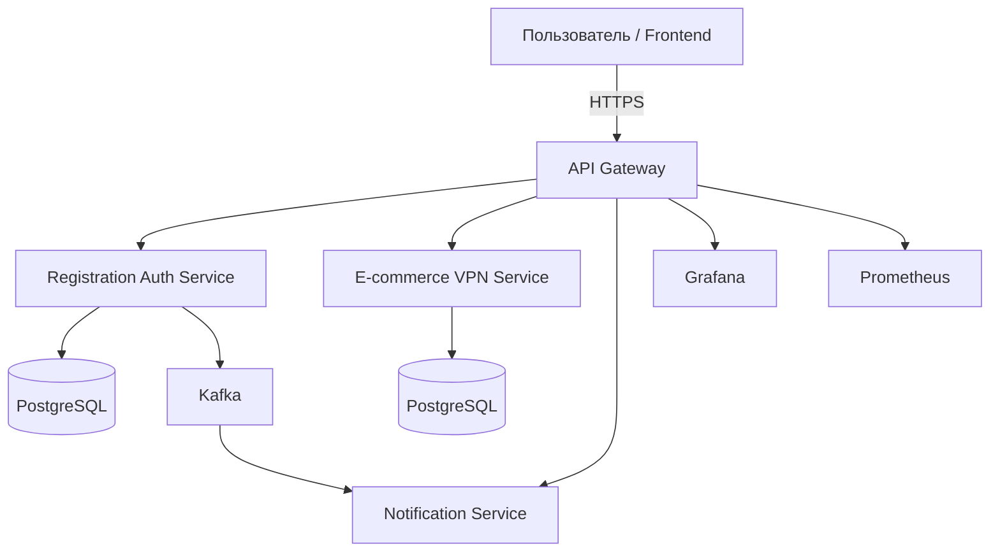

# Pet Project Monorepo

Микросервисный SaaS-проект для управления доступом, пользователями, уведомлениями и маршрутизацией запросов между сервисами. Репозиторий демонстрирует практику построения распределённой архитектуры, контейнеризации, безопасности и организации инфраструктуры для локального и демонстрационного запуска.

## Архитектура



## Что входит в проект

- API Gateway — единая точка входа, JWT-проверка, проксирование запросов, мониторинг и Grafana
- Registration Backend — регистрация, авторизация, JWT, пользовательский профиль
- E-commerce VPN — бизнес-логика VPN сервиса, управление устройствами, профилем клиента, оплатами и тарифами
- Notification Service — отправка уведомлений в Telegram и интеграция с событиями
- Prometheus + Grafana — сбор метрик и визуализация состояния системы
- Docker Compose — единая локальная среда запуска всего монорепозитория

## Технологический стек

- Python 3.11+
- FastAPI
- SQLAlchemy + Async SQLAlchemy
- PostgreSQL
- JWT / OAuth-like access-token flow
- Kafka producer/consumer patterns
- Docker / Docker Compose
- Prometheus + Grafana
- HTTPX, Pydantic, Alembic

## Структура репозитория

```text
pet-project-mono-repo/
├── docker-compose.yml
├── .env.example
├── README.md
├── infra/
├── services/
│   ├── API-Gateway-service/
│   ├── E-commerce-vpn/
│   ├── Registration-backend-service/
│   └── notification-service/
└── shared/
```

## Быстрый старт

### 1. Клонирование

```bash
git clone https://github.com/your-username/pet-project-mono-repo.git
cd pet-project-mono-repo
```

### 2. Настройка окружения

```bash
cp .env.example .env
```

### 3. Запуск всех сервисов

```bash
docker compose up --build
```

## Основные точки входа

- API Gateway: http://localhost:8000
- Grafana: http://localhost:3000
- Prometheus: http://localhost:9090
- Registration service: internal Docker network endpoint
- VPN service: internal Docker network endpoint
- Notification service: internal Docker network endpoint

## Принципы архитектуры

### Разделение ответственности

Каждый сервис отвечает только за свою область:
- Gateway — маршрутизация и безопасность
- Auth — идентификация и токены
- VPN — доменная логика SaaS-процесса
- Notification — события и оповещения

### Контейнеризация

Вся система запускается через `docker compose`, что упрощает локальную разработку, тестирование и демонстрацию проекта.

### Наблюдаемость

Система включает:
- Prometheus для сбора метрик
- Grafana для dashboards
- health-check endpoints

## Риски и улучшения для production

В текущем пет-проекте уже есть базовая архитектурная основа, но для продакшена стоит дополнительно реализовать:

- полноценный API gateway с rate limiting и circuit breaker
- ролевую модель доступа и policy-based security
- миграции и версионирование схемы данных
- CI/CD pipeline
- structured logging и централизованный сбор логов
- секреты через Docker Swarm, Kubernetes или managed secrets

## Роль проекта в портфолио

Этот репозиторий демонстрирует:
- понимание микросервисной архитектуры
- контейнеризацию и orchestration
- работу с внутренней сетью сервисов
- реализацию auth/identity flow
- мониторинг и observability
- подход к проектированию production-friendly software systems

## Сервисы проекта

- [services/API-Gateway-service/README.md](services/API-Gateway-service/README.md)
- [services/E-commerce-vpn/README.md](services/E-commerce-vpn/README.md)
- [services/Registration-backend-service/README.md](services/Registration-backend-service/README.md)
- [services/notification-service/README.md](services/notification-service/README.md)

